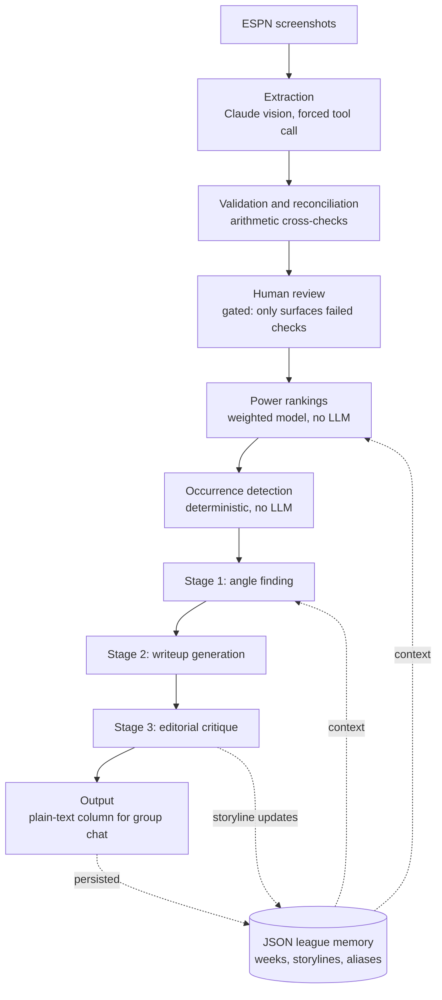

# Fantasy Football Power Rankings

A local-first Streamlit app that turns ESPN fantasy football screenshots into a weekly power
rankings column with humorous commentary, for a private league. Claude's vision model extracts
structured data from the screenshots via a forced tool call, that data is cross-checked
arithmetically against the previous week before anything is trusted, and a transparent weighted
model computes the rankings. A three-stage LLM pipeline then writes the commentary, grounded
throughout in deterministically computed facts rather than the model's own recollection.

The interesting engineering problem here is not calling an LLM — it is constraining one. Most of
the code exists to make the model's output verifiable, to compute facts rather than ask for them,
and to enforce in code the rules the model proved unable to follow from instructions alone.

## Architecture



Stages 1–3 are separate API calls. Splitting them means the model decides *what the joke is*
before it writes, and reviews its own draft afterwards, rather than doing all three jobs in one
pass.

## Data extraction and verification

Screenshots are sent to Claude's vision model with `tool_choice` forced to a single tool, so the
response is always a valid structured object rather than prose to be parsed. The schema captures
team names, managers, records, win/loss streaks, points for and against, divisions, playoff odds,
scores, and ESPN's projected scores.

Vision output is never trusted directly. Because the scoreboard and standings screenshots overlap,
the numbers can be **proven rather than proofread**:

- season points-for must increase by exactly this week's score
- points-against must increase by exactly the opponent's score
- the record must advance by one game, on the correct side
- the win/loss streak must follow from this week's result

These are week-over-week deltas rather than season sums, so they hold even when a league starts
uploading mid-season and the app has never seen earlier weeks. When every check passes the review
table stays collapsed; when one fails it names the exact team and field. A season's first week has
nothing to compare against and reports that honestly rather than implying verification occurred.

## Ranking model

The power score is a transparent weighted blend, computed in code with no LLM involvement.

| Component | Weight | What it measures |
|---|---|---|
| Points scored | 40% | Points per game |
| Recent form | 30% | Last up to 3 weeks (win rate and margin) |
| Season performance | 30% | Win/loss record |
| Roster strength | 0% | Not computable — see below |
| Consistency | 0% | Computed and visible, contributes nothing |
| Schedule context | 0% | Computed and visible, contributes nothing |

**Roster strength is never scored.** Screenshots expose team-level projections, not per-player
points, so there is no honest way to compute it — and the app is built to never invent a number it
cannot derive. Its weight redistributes across the components that can be computed. The same
mechanism handles components that are temporarily unavailable: consistency needs two weeks of
history, schedule context needs played games, so week 1 still produces a valid ranking from a
narrower blend, flagged internally at low confidence.

**Consistency and schedule are zeroed on evidence, not preference.** Tested against 84 team-weeks
of real league history, correlation with the *following* week's score was +0.39 for recent form,
+0.39 for points per game and +0.17 for record — but **−0.25 for consistency and −0.24 for
schedule strength**. Neither measures what its name implies: consistency is −0.62 correlated with
points per game, because a team averaging 95 cannot swing 40 points, making low variance a proxy
for low scoring; schedule strength is −0.50 correlated with a team's own record, because
opponents' win rates include the games they played against you. They are zeroed rather than
deleted so the values stay visible and the decision is reversible.

The resulting score orders the column and nothing else. It is never shown to readers, and the
writing stage is explicitly forbidden from naming it.

## Narrative pipeline

Before any writing happens, `src/occurrences.py` detects what actually occurred that week from
data already on hand — blowouts, one-score games, scoring streaks, large misses against ESPN's
projection, rank swings, playoff-odds collapses, and cases where a team outscored every opponent
except the one it played. Sixteen occurrence types, all deterministic and free.

A team with nothing notable receives an explicit empty marker, and that silence is load-bearing:
it is what produces a one-line entry rather than a paragraph manufactured out of season averages.
Length follows material.

The three LLM stages then run in sequence:

1. **Angle finding** — selects the comedic premise for each team from the detected occurrences,
   user-supplied context, and active storylines. Also proposes storyline updates.
2. **Writeup generation** — writes to the selected angle, at a length set by how much material
   exists.
3. **Editorial critique** — reviews the draft against explicit failure modes and rewrites what
   fails, including a separate verification pass over the awards and recap.

Every generation is measured against a reference corpus of past columns, and the result is shown
in the UI: mean word count, spread, and any rule violations such as exceeding the length ceiling
or naming the power score. Drift is visible the week it happens rather than months later.

## Design decisions

**Forced tool calls for all structured output.** Every model call uses
`tool_choice={"type": "tool", ...}`, so responses are schema-conforming objects. No prose parsing,
no retry-on-malformed-JSON, no partial states.

**Rules enforced in code where the model proved unreliable.** Instructions alone did not hold for
several constraints, so they are implemented deterministically instead:

- `cap_fraud_lens_angles` limits how many teams may use the same record-versus-quality framing.
  Two real generations showed the model could not self-count and enforce this during critique, so
  it runs on the returned angle data before writing begins — at zero additional API cost.
- `_normalize_tiers` rebuilds tier groupings from the authoritative rank order, since the model
  sometimes grouped teams thematically across non-adjacent ranks.
- `sanitize_model_output` decodes literal escape sequences that occasionally appear as text in
  tool-call strings and would otherwise reach the final output verbatim.
- `profile_writeups` measures each generation against the reference corpus and surfaces
  violations in the UI.

**Conditions rather than style dials.** The prompt specifies what must be true given the inputs,
not stylistic quotas. Length is a function of how much a team's week actually contained, with a
hard ceiling applied regardless. Techniques are permitted rather than required — an instruction
to use a device "often" reliably produces it every single week, which is precisely how a voice
becomes a tic. Where a technique was under-used, the fix was removing the prohibition on it
rather than adding a mandate.

**Storylines as structured memory, not replayed text.** Multi-week narratives are stored as typed
records (title, teams, status, dated events) on the league. Future weeks receive only the
storylines relevant to each team, rather than every past week's full prose. This keeps prompt size
flat as the season grows and avoids the model reusing old wording verbatim instead of writing new
material.

**Targeted regeneration.** Three granularities, so fixing one thing does not mean paying to redo
everything: a single team's writeup (one API call, leaving the rest of the page untouched), the
awards and recap alone (one call — these make league-wide counting claims and are the most
error-prone section), or a full week rewritten from already-extracted data (three calls, no
re-upload and no vision call). Each path rolls back that week's storyline events first, since
storyline updates append and would otherwise be recorded twice.

**JSON files over a database.** One file per league holds the entire history. No server, no
migrations, no auth. The persistence layer is small enough to read in one sitting, and the data is
inspectable with a text editor.

## Setup

```bash
cd fantasy-football-power-rankings
python3 -m venv .venv
source .venv/bin/activate
pip install -r requirements.txt

cp .env.example .env
# set ANTHROPIC_API_KEY in .env
# (https://console.anthropic.com/settings/keys)
```

Requires Python 3.10+ and an Anthropic API key. `ANTHROPIC_MODEL` and `FPR_DEBUG` are optional
overrides documented in `.env.example`.

## Running it

```bash
source .venv/bin/activate
streamlit run app.py
```

Opens at `http://localhost:8501`. Per league, per week:

1. Select the league in the sidebar, or create it on first use.
2. Upload the scoreboard and standings screenshots. Standings columns often span two screenshots
   on a phone; both are merged.
3. Set the week number (defaults to last week plus one).
4. Optionally add a sentence or two of context — trades, injuries, a notable lineup decision.
   This is the highest-value input available, since it covers events the screenshots cannot show.
5. Extract. Check the reconciliation banner; open the review table only if something failed.
6. Generate. This runs the ranking model, then the three narrative stages.
7. Copy the plain-text output, or regenerate a single team, the awards, or the whole week.

The History tab retrieves any previous week and provides the rewrite and delete controls. Sidebar
panels hold persistent league notes and logged events that future weeks can draw on.

## Tests

```bash
source .venv/bin/activate
pip install -r requirements-dev.txt
python -m pytest tests/ -q
```

**72 tests, running in roughly one second.** The suite uses hand-built fixtures exclusively — no
screenshots, no API calls, no cost — and covers the ranking mathematics, team-name normalization
and alias resolution, storyline lifecycle, occurrence detection, week-over-week reconciliation
(including deliberately corrupted inputs to confirm the checks actually fail), output
sanitization, and the week deletion and rewrite paths.

## Project layout

```
app.py                  Streamlit UI, export formatting, workflow orchestration
src/
  data_extraction.py    Screenshots to structured data (Claude vision, forced tool call)
  data_validation.py    Name normalization, shape checks, week-over-week reconciliation
  occurrences.py        Deterministic detection of what happened this week
  rankings.py           The weighted power-ranking model
  narratives.py         Angle finding, writeup generation, editorial critique, profiling
  prompts.py            Shared tone, style and factual-constraint text
  memory.py             JSON persistence: leagues, weeks, storylines, team-name aliases
tests/                  Fixture-based tests, no network access
reference/              Template for calibrating voice against your own past columns
data/leagues/*.json     One file per league (gitignored — contains real names)
```

## Known limitations and roadmap

- **No ESPN API integration.** Screenshots only, which caps what is knowable: team-level data is
  available, per-player data is not. A bad lineup decision or an injury can only reach the column
  through the weekly context box. API access would remove that ceiling and enable a real roster
  strength component.
- **Projections are unverified.** Every other extracted field is cross-checked against the
  previous week, but a projection is a standalone number with no redundancy to check it against.
- **League-wide superlatives across weeks are not yet pre-computed.** Single-week placement claims
  are verifiable against a pre-sorted scoreboard supplied to the model; season-long leaderboards
  and rank-movement rankings are not, and remain the main residual source of factual error.
- **Single user, single machine.** No authentication, no cloud hosting, no multi-user support.
- Planned: a luck index, Monte Carlo playoff odds, automatic trade detection from roster diffs,
  and per-stage model selection to reduce cost.
