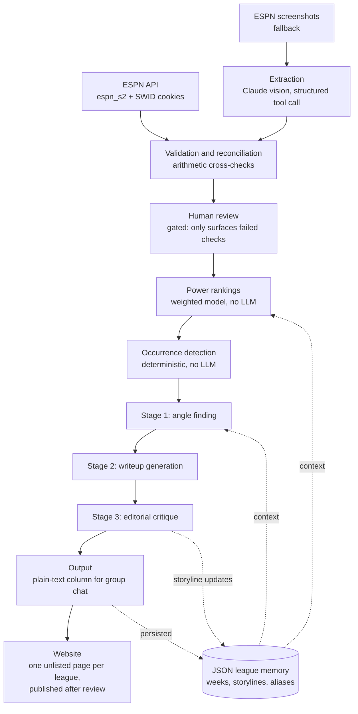

# Fantasy Football Power Rankings

A local-first Streamlit app that turns a week of ESPN fantasy football into a paste-ready power
rankings column with humorous commentary, for private leagues. League data comes straight from
ESPN's API (scores, standings, projections and full lineups) or, as a fallback, from screenshots
read by Claude's vision model. Either way the numbers are cross-checked arithmetically against the
previous week before anything is trusted, and a transparent weighted model computes the rankings.
A three-stage LLM pipeline then writes the commentary, grounded throughout in deterministically
computed facts rather than the model's own recollection.

Each week can go out two ways: as plain text for the group chat, or published to a small website
with one unlisted page per league. The site has the column for every week, season charts
(lucky-or-good, wins above expected, the rank race), records, a trophy case, and a page per team
with every line the column has written about it. A scheduled Tuesday-morning job pulls and writes
every league unattended; nothing is published until you have read it.

The interesting engineering problem here is not calling an LLM — it is constraining one. Most of
the code exists to make the model's output verifiable, to compute facts rather than ask for them,
and to enforce in code the rules the model proved unable to follow from instructions alone.

## Architecture



Stages 1–3 are separate API calls. Splitting them means the model decides *what the joke is*
before it writes, and reviews its own draft afterwards, rather than doing all three jobs in one
pass.

## Data extraction and verification

When a league is connected to ESPN, the pull returns structured data directly and no model is
involved. Otherwise screenshots are sent to Claude's vision model with a strict tool schema, so the
response is a schema-conforming object rather than prose to be parsed. The schema captures
team names, managers, records, win/loss streaks, points for and against, divisions, playoff odds,
scores, and ESPN's projected scores.

Neither source is trusted directly. Because the scoreboard and standings screenshots overlap,
the numbers can be **proven rather than proofread**:

- season points-for must increase by exactly this week's score
- points-against must increase by exactly the opponent's score
- the record must advance by one game, on the correct side
- the win/loss streak must follow from this week's result

These are week-over-week deltas rather than season sums, so they hold even when a league starts
uploading mid-season and the app has never seen earlier weeks. When every check passes the review
table stays collapsed; when one fails it names the exact team and field. A season's first week has
nothing to compare against and reports that honestly rather than implying verification occurred.

## Ranking model

The power score is a transparent weighted blend, computed in code with no LLM involvement.

| Component | Weight | What it measures |
|---|---|---|
| Points scored | 40% | Points per game |
| Recent form | 30% | Last up to 3 weeks (win rate and margin) |
| Season performance | 30% | Win/loss record |
| Roster strength | 0% | Not computable — see below |
| Consistency | 0% | Computed and visible, contributes nothing |
| Schedule context | 0% | Computed and visible, contributes nothing |

**Roster strength is never scored.** Screenshots expose team-level projections, not per-player
points, so there is no honest way to compute it — and the app is built to never invent a number it
cannot derive. Its weight redistributes across the components that can be computed. The same
mechanism handles components that are temporarily unavailable: consistency needs two weeks of
history, schedule context needs played games, so week 1 still produces a valid ranking from a
narrower blend, flagged internally at low confidence.

**Consistency and schedule are zeroed on evidence, not preference.** Tested against 84 team-weeks
of real league history, correlation with the *following* week's score was +0.39 for recent form,
+0.39 for points per game and +0.17 for record — but **−0.25 for consistency and −0.24 for
schedule strength**. Neither measures what its name implies: consistency is −0.62 correlated with
points per game, because a team averaging 95 cannot swing 40 points, making low variance a proxy
for low scoring; schedule strength is −0.50 correlated with a team's own record, because
opponents' win rates include the games they played against you. They are zeroed rather than
deleted so the values stay visible and the decision is reversible.

The resulting score orders the column and nothing else. It is never shown to readers, and the
writing stage is explicitly forbidden from naming it.

## Narrative pipeline

Before any writing happens, `src/occurrences.py` detects what actually occurred that week from
data already on hand — blowouts, one-score games, scoring streaks, large misses against ESPN's
projection, rank swings, playoff-odds collapses, and cases where a team outscored every opponent
except the one it played, plus the lineup decisions described under the ESPN pull below. About
twenty occurrence types, all deterministic and free. Each team gets at most its three strongest,
so the writer is handed a story rather than a list.

A team with nothing notable receives an explicit empty marker, and that silence is load-bearing:
it is what produces a one-line entry rather than a paragraph manufactured out of season averages.
Length follows material.

The three LLM stages then run in sequence:

1. **Angle finding** — selects the comedic premise for each team from the detected occurrences,
   user-supplied context, and active storylines. Also proposes storyline updates.
2. **Writeup generation** — writes to the selected angle, at a length set by how much material
   exists.
3. **Editorial critique** — reviews the draft against explicit failure modes and rewrites what
   fails, including a separate verification pass over the awards and recap.

Every generation is measured against a reference corpus of past columns, and the result is shown
in the UI: mean word count, spread, and any rule violations such as exceeding the length ceiling
or naming the power score. Drift is visible the week it happens rather than months later.

## Design decisions

**Structured output through one helper.** Every model call goes through `src/llm.call_tool`,
which sends the tool schema with `strict: true` and asks for exactly one call. Claude Opus 5.5
rejects a forced `tool_choice`, so the helper uses `auto` and retries once if no call comes back.
No prose parsing, no partial states. The system prompt is marked for prompt caching, since it is
identical across the three narrative stages.

**Rules enforced in code where the model proved unreliable.** Instructions alone did not hold for
several constraints, so they are implemented deterministically instead:

- `cap_fraud_lens_angles` limits how many teams may use the same record-versus-quality framing.
  Two real generations showed the model could not self-count and enforce this during critique, so
  it runs on the returned angle data before writing begins — at zero additional API cost.
- `_normalize_tiers` rebuilds tier groupings from the authoritative rank order, since the model
  sometimes grouped teams thematically across non-adjacent ranks.
- `sanitize_model_output` decodes literal escape sequences that occasionally appear as text in
  tool-call strings and would otherwise reach the final output verbatim.
- `profile_writeups` measures each generation against the reference corpus and surfaces
  violations in the UI.

**Conditions rather than style dials.** The prompt specifies what must be true given the inputs,
not stylistic quotas. Length is a function of how much a team's week actually contained, with a
hard ceiling applied regardless. Techniques are permitted rather than required — an instruction
to use a device "often" reliably produces it every single week, which is precisely how a voice
becomes a tic. Where a technique was under-used, the fix was removing the prohibition on it
rather than adding a mandate.

**Storylines as structured memory, not replayed text.** Multi-week narratives are stored as typed
records (title, teams, status, dated events) on the league. Future weeks receive only the
storylines relevant to each team, rather than every past week's full prose. This keeps prompt size
flat as the season grows and avoids the model reusing old wording verbatim instead of writing new
material.

**Targeted regeneration.** Three granularities, so fixing one thing does not mean paying to redo
everything: a single team's writeup (one API call, leaving the rest of the page untouched), the
awards and recap alone (one call — these make league-wide counting claims and are the most
error-prone section), or a full week rewritten from already-extracted data (three calls, no
re-upload and no vision call). Each path rolls back that week's storyline events first, since
storyline updates append and would otherwise be recorded twice.

**JSON files over a database.** One file per league holds the entire history. No server, no
migrations, no auth. The persistence layer is small enough to read in one sitting, and the data is
inspectable with a text editor.

## Setup

```bash
cd fantasy-football-power-rankings
python3 -m venv .venv
source .venv/bin/activate
pip install -r requirements.txt

cp .env.example .env
# set ANTHROPIC_API_KEY in .env
# (https://console.anthropic.com/settings/keys)
```

Requires Python 3.10+ and an Anthropic API key. `ANTHROPIC_MODEL` and `FPR_DEBUG` are optional
overrides documented in `.env.example`.

## Running it

```bash
source .venv/bin/activate
streamlit run app.py
```

Opens at `http://localhost:8501`. Per league, per week:

1. Select the league in the sidebar, or create it with **➕ New league**. The choice is kept in the
   URL, so a refresh stays on the same league.
2. Check the week number. It moves to the next unwritten week on its own, and the ESPN pull and
   the saved week always use this one field, so a week-2 pull can't be filed as week 9.
3. **⬇️ Pull week N from ESPN**, or upload the scoreboard and standings screenshots and extract.
4. Optionally add a sentence or two of context. Most weeks need none: the ESPN pull already covers
   bench decisions and no-shows, which used to be the main reason to type anything.
5. Check the reconciliation banner; open the review table only if something failed.
6. Generate. This runs the ranking model, then the three narrative stages.
7. Copy the plain-text output, or regenerate a single team, the awards, or the whole week.

The History tab retrieves any previous week and provides the rewrite and delete controls. The
sidebar holds each league's notes, logged events, team-rename links, and rename/delete.

## Pulling from ESPN instead of screenshots

Add two cookies to `.env` once, then connect each league on its page with **🔗 Connect this
league to ESPN**, using the number after `leagueId=` in the league's URL:

```
ESPN_S2=...
ESPN_SWID={...}
```

Both come from your browser at `fantasy.espn.com` — DevTools, Application, Cookies. They identify
your ESPN account, not a league, so one pair reads every league you belong to. **`espn_s2` is a
full account session token; treat it as a password.** It lasts months but ends if you log out
everywhere or change your password; every league then fails with access denied until you paste a
fresh one. Screenshots keep working, and remain the
fallback when a cookie expires or ESPN changes something, which it has done before.

The API supplies everything the screenshots did, plus full lineups. That unlocks detections the
screenshot path cannot reach:

- **Bench gaps**, flex-aware, so a tight end out-scoring a receiver started in the flex is caught.
  Only ones worth a line are kept: the gap would have won the game, it was 20+ points, or it was
  the league's biggest. At most three lineup lines run per week.
- **Called wrong both ways**: a player benched the week he went off and started the week he
  didn't, or the reverse. Both calls must have cost 10+ points and his own score must have swung
  10+.
- **Started a player who didn't play**, or one on a bye.
- **League-wide superlatives** (biggest miss of projection, biggest bench gap) are computed in code
  and handed over, never left to the writer, and ties get no crown.

Injury labels are never used. ESPN reports a player's status *now*, not at kickoff of the week
being asked about, so a past week showed "OUT" for players who had played and scored well. Whether
a player played comes from his actual stat line for that week instead.

## Unattended weekly runs

```bash
python scripts/weekly_run.py --dry-run     # pull and verify every league, spend nothing
python scripts/weekly_run.py               # pull, verify and write up
python scripts/weekly_run.py --week 9      # force a week
python scripts/weekly_run.py --league id   # one league only
```

It writes each league's next unwritten week, and only once ESPN shows every game in it as
final. It does not rely on when ESPN rolls `current_week` over, which used to make a run that came
too early silently skip. Behaviour is deliberately conservative, since nothing is watching when it
runs:

- **A week that already has writeups is never regenerated**, so re-running is free and safe.
- **A week that isn't final yet waits** and is picked up by the next run.
- **A reconciliation failure blocks generation.** The pulled data is saved for review, but no
  column is written. A late column is recoverable; a wrong one is not.
- **Leagues are independent.** A dead cookie on one does not stop the others.
- **Per-league opt-out.** Untick "Write this league automatically on Tuesday mornings" in a
  league's ESPN settings (for test leagues); `--league id` still runs it by hand.

`--notify` shows a macOS notification when a column is ready or a league needs a look. Exit codes:
`0` all generated, skipped or waiting, `1` something needs attention, `2` credentials missing.
Output goes to stdout and `logs/weekly_run.log`.

To schedule it on macOS, use a launchd agent rather than cron: launchd runs a missed job when the
Mac wakes, where cron skips it. Save as `~/Library/LaunchAgents/com.fantasy-power-rankings.weekly.plist`,
with your own path, then `launchctl bootstrap gui/$(id -u) <that file>`:

```xml
<?xml version="1.0" encoding="UTF-8"?>
<!DOCTYPE plist PUBLIC "-//Apple//DTD PLIST 1.0//EN" "http://www.apple.com/DTDs/PropertyList-1.0.dtd">
<plist version="1.0">
<dict>
  <key>Label</key><string>com.fantasy-power-rankings.weekly</string>
  <key>ProgramArguments</key>
  <array>
    <string>/bin/zsh</string><string>-c</string>
    <string>cd "/path/to/fantasy-football-power-rankings" &amp;&amp; exec .venv/bin/python scripts/weekly_run.py --notify --quiet</string>
  </array>
  <key>StandardOutPath</key><string>/Users/you/Library/Logs/fantasy-power-rankings.log</string>
  <key>StandardErrorPath</key><string>/Users/you/Library/Logs/fantasy-power-rankings.log</string>
  <key>StartCalendarInterval</key>
  <array>
    <dict><key>Weekday</key><integer>2</integer><key>Hour</key><integer>9</integer><key>Minute</key><integer>0</integer></dict>
    <dict><key>Weekday</key><integer>2</integer><key>Hour</key><integer>10</integer><key>Minute</key><integer>0</integer></dict>
    <dict><key>Weekday</key><integer>2</integer><key>Hour</key><integer>11</integer><key>Minute</key><integer>0</integer></dict>
  </array>
</dict>
</plist>
```

The 10 and 11 o'clock entries are free retries in case ESPN hasn't finalised the week by 9. Keep
the log paths outside `~/Documents`: launchd refuses to open them there and the job exits with
code 78 before Python starts.

## Website

Each league can have its own page: the column for every week, a season view (lucky-or-good
chart, wins above expected, the rank race, records, trophy case) and a page per team with its
whole season's rap sheet. One site, one unlisted address per league
(`/my-league-3f9a1c/`), and nothing links the leagues together, so each group chat only sees its
own. Search engines are told to stay out. Manager names, league notes and storylines never leave
your machine; the site shows team names only.

**Only weeks you publish go out.** Each league remembers the last week you published, so a
column the Tuesday run wrote but you haven't read can't reach the site, even when you publish a
different league. Tuesday becomes: notification, review in the app, **🚀 Publish week N** in the
sidebar, send the link (the league's address always shows its newest week). After regenerating
anything, **🔄 Republish**. **👀 Preview first** builds every league locally, unreviewed week
included, and opens it without uploading anything.

Hosting is Cloudflare Pages, free. The built pages upload straight from your machine and never
go through git, so real team names stay off this public repo. One-time setup:

1. Create a free account at `dash.cloudflare.com`. Your **account ID** is on the right of the
   account home page.
2. My Profile → API Tokens → Create Token → *Create Custom Token*, with one permission:
   **Account · Cloudflare Pages · Edit**.
3. Add both to `.env` as `CLOUDFLARE_API_TOKEN` and `CLOUDFLARE_ACCOUNT_ID`, and restart the app.
4. Publish once. Cloudflare prints the site's address; if it isn't
   `https://power-rankings.pages.dev` (the name can be taken), set `SITE_URL` in `.env` to what
   it printed and republish, so link previews point at the right place.

Requires Node.js (`npx`) for the upload. From the terminal:

```bash
python scripts/publish_site.py --preview             # build everything, serve at localhost:8765
python scripts/publish_site.py --league my_league  # publish that league's latest week
python scripts/publish_site.py                       # rebuild and redeploy what's published
```

## Tests

```bash
source .venv/bin/activate
pip install -r requirements-dev.txt
python -m pytest tests/ -q
```

**195 tests, running in a couple of seconds.** The suite uses hand-built fixtures exclusively — no
screenshots, no API calls, no cost — and covers the ranking mathematics, team-name normalization
and alias resolution, storyline lifecycle, occurrence detection, week-over-week reconciliation
(including deliberately corrupted inputs to confirm the checks actually fail), output
sanitization, and the week deletion and rewrite paths.

## Project layout

```
app.py                  Streamlit UI, export formatting, workflow orchestration
src/
  llm.py                The one place model calls happen: strict tool schema, caching, retry
  data_extraction.py    Screenshots to structured data (Claude vision, strict tool call)
  data_validation.py    Name normalization, shape checks, week-over-week reconciliation
  occurrences.py        Deterministic detection of what happened this week
  rankings.py           The weighted power-ranking model
  narratives.py         Angle finding, writeup generation, editorial critique, profiling
  espn_sync.py          Direct ESPN pull, emitting the same shape as screenshot extraction
  weekly_run.py         Unattended per-league run, used by scripts/weekly_run.py
  site_build.py         Builds the per-league website and uploads it to Cloudflare Pages
  prompts.py            Shared tone, style and factual-constraint text
  memory.py             JSON persistence: leagues, weeks, storylines, team-name aliases
scripts/weekly_run.py   CLI entry point for the scheduled run
scripts/publish_site.py Build, preview or publish the website
site/template.html      The website's page template (no data in it)
tests/                  Fixture-based tests, no network access
reference/              Template for calibrating voice against your own past columns
data/leagues/*.json     One file per league (gitignored — contains real names)
```

## Known limitations and roadmap

- **The screenshot path is team-level only.** Leagues not connected to ESPN get no lineup facts;
  bench decisions can only reach the column through the context box. Roster strength stays at 0%
  weight even for connected leagues for now.
- **Projections are unverified.** Every other extracted field is cross-checked against the
  previous week, but a projection is a standalone number with no redundancy to check it against.
- **Season-long superlatives are not pre-computed.** Single-week ones are; season leaderboards
  are not, and a "season high" is only claimed with six weeks of history and a real margin.
- **Single user, single machine.** No authentication, no cloud hosting, no multi-user support.
- Planned: a luck index, Monte Carlo playoff odds, automatic trade detection from roster diffs,
  and per-stage model selection to reduce cost.

The default model is `claude-opus-5-5`; set `ANTHROPIC_MODEL=claude-opus-5` in `.env` to roll back.
